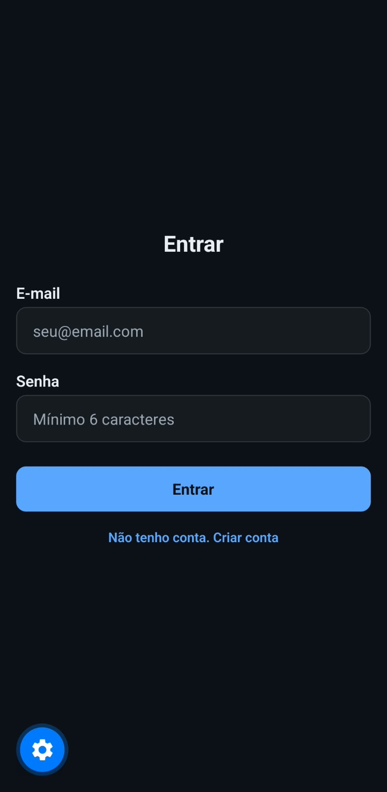
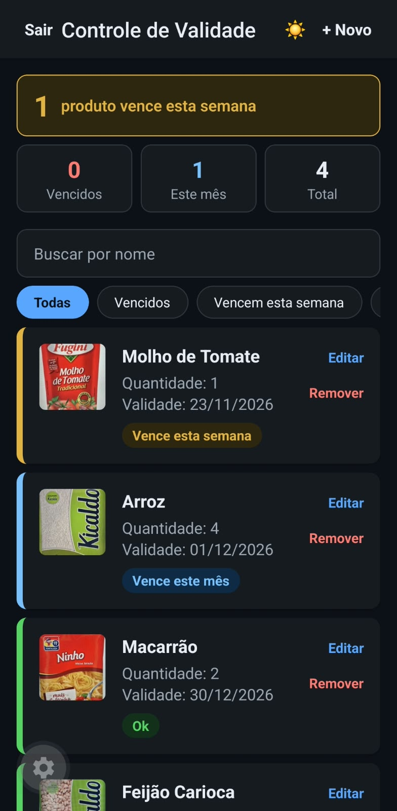
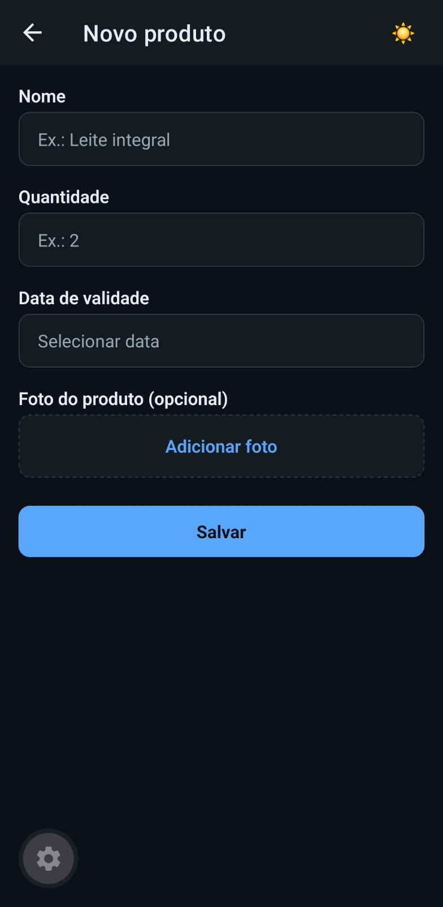
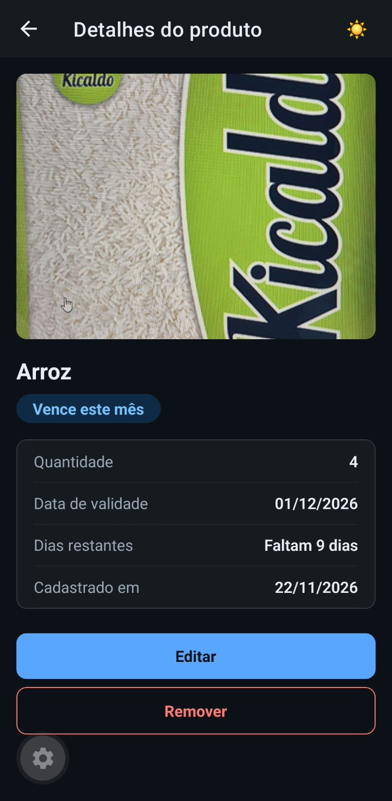
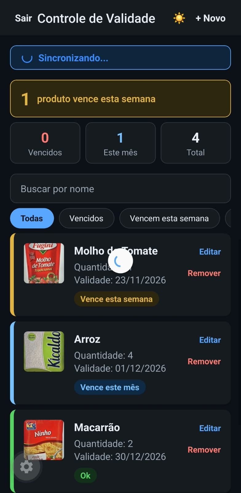
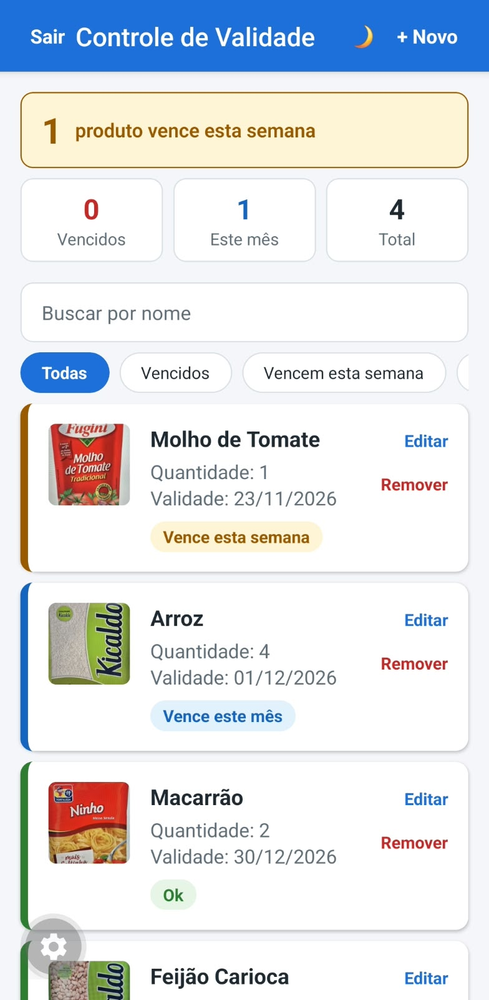

# Controle de Validade de Alimentos

**Disciplina:** Programação para Dispositivos Móveis
**Grupo:** Paulo Moura Menezes, Arthur Alexandre Bento dos Santos e João Victor Lucena

## 1. Tema e objetivo

Aplicativo mobile desenvolvido em React Native com Expo para registro e controle de alimentos perecíveis, voltado a reduzir o desperdício causado por vencimento não percebido e falta de aviso antecipado.

O sistema entregue oferece autenticação por e-mail e senha (login e criação de conta), cadastro e edição de produtos com foto pela câmera ou galeria, listagem ordenada pela data de validade mais próxima, busca local por nome sem diferenciação de acentos, filtros por situação (`vencido`, `venceEstaSemana`, `venceEsteMes` e `ok`), painel de contadores, tela de detalhes com dias restantes, remoção completa com limpeza de foto e alerta, notificações locais 3 dias antes do vencimento, sincronização offline-first com API remota, indicador de pendências na listagem e alternância entre tema claro e escuro.

## 2. Tecnologias

- **App mobile:** React Native (`0.86.3`), React (`19.2.3`) e Expo (`~57.0.31`)
- **Navegação:** React Navigation (`@react-navigation/native` `^7.5.0` e `@react-navigation/native-stack` `^7.20.0`)
- **Recursos do dispositivo e armazenamento local:** `expo-file-system` (`~57.0.7`, API `expo-file-system/legacy`), `expo-image-picker` (`~57.0.20`), `expo-notifications` (`~57.0.24`) e `@react-native-community/datetimepicker` (`9.1.0`)
- **Backend:** Node.js com Express (`^4.21.2`), `pg` (`^8.13.1`), `cors` (`^2.8.5`) e `dotenv` (`^16.4.7`)
- **Autenticação e segurança:** JWT com `jsonwebtoken` (`^9.0.2`, validade de 30 dias) e hash de senhas com `bcrypt` (`^5.1.1`, custo 12)
- **Banco de dados e hospedagem:** PostgreSQL hospedado no Neon e API publicada no Render (plano Free)
- **Testes:** Jest (`jest-expo` no app e `jest` + `supertest` no backend)

## 3. Justificativa do React Navigation

O requisito RF05 do PDF da disciplina cita o Expo Router. O projeto usa React Navigation porque o template base é o blank do Expo e o Expo Router foi descartado na fase de decisões (ver `## Histórico de decisões` abaixo).

Em `App.js`, a navegação utiliza `NavigationContainer` e `createNativeStackNavigator`, alternando de forma mutuamente exclusiva entre a rota `Login` (quando não há sessão local) e a pilha principal (`Inicial`, `Cadastro` e `TelaDetalhe`), impedindo que o usuário retorne ao login pelo botão voltar após autenticar.

## 4. Justificativa da persistência

- **Persistência local:** os produtos (`produtos.json`), a sessão autenticada (`sessao.json`), a fila offline (`fila_sincronizacao.json`), a preferência de tema (`tema.json`) e as fotos (`fotos/`) ficam armazenados na pasta de documentos do aparelho via `expo-file-system/legacy`. A escolha se deve à simplicidade do domínio (listas pequenas lidas por completo), ao reaproveitamento da mesma camada de arquivos usada pelas fotos e à facilidade de gravação atômica na fila (escrita em arquivo temporário seguida de renomeação).
- **Persistência remota (API):** o backend utiliza PostgreSQL hospedado no Neon em vez de SQLite porque o plano gratuito do Render não mantém arquivos entre reinícios, então um banco SQLite em arquivo local se perderia.

## 5. Arquitetura offline-first

As telas consomem `OfflineFirstProdutoRepository` (implementando o contrato `ProdutoRepository`), que coordena três fontes: cache local em JSON (`JsonProdutoRepository`), fila persistente FIFO em `fila_sincronizacao.json` (`FilaSincronizacao`, com `usuarioId` em cada item e gravação atômica) e API remota (`ApiProdutoRepository`).

Escritas gravam primeiro no cache local, enfileiram a operação (`SALVAR`, `ATUALIZAR` ou `REMOVER`) com o `usuarioId` da sessão e disparam o envio em segundo plano sem bloquear a interface. A fila do usuário ativo é drenada ao abrir ou focar a `TelaInicial`, ao tocar no banner `IndicadorSincronizacao` ou ao puxar a lista para atualizar; com a fila vazia, o cache local espelha a base remota.

Regras de sincronização implementadas em `data/OfflineFirstProdutoRepository.js`:

- **Erro de rede, `408`, `429` ou `5xx`:** a sincronização é interrompida e o item (junto aos seguintes) permanece na fila para envio posterior.
- **Resposta `401`:** a sincronização é interrompida mantendo a fila intacta; a sessão local é apagada e o aplicativo volta à tela de login para o usuário se autenticar novamente.
- **Demais respostas `4xx` (exceto `401`, `408` e `429`):** o item rejeitado em definitivo pelo servidor é descartado da fila e a sincronização segue com os próximos itens.

No logout (`Sair`), o app aguarda a rodada de sincronização em andamento (até o tempo-limite configurado), bloqueia a saída caso existam operações pendentes do usuário na fila e, sem pendências, limpa o cache local antes de encerrar a sessão.

## 6. Execução do backend

A API está na pasta `backend/` e exige a configuração das variáveis de ambiente `DATABASE_URL` (conexão PostgreSQL), `JWT_SECRET` (segredo para assinatura dos tokens, obrigatório na inicialização) e `PORT` (porta HTTP, padrão `3000`; definida automaticamente no Render). Nenhuma credencial ou valor real deve ser versionado.

O passo a passo completo de execução local, testes (`npm test` em `backend/`), contrato das rotas e deploy em produção (Render + Neon) está documentado em [backend/README.md](backend/README.md).

## 7. Execução do app

Na raiz do repositório, instale as dependências e inicie o Expo:

```bash
npm install
npx expo start
```

Crie um arquivo `.env` na raiz do projeto (ignorado pelo Git) definindo a variável `EXPO_PUBLIC_API_URL`, lida por `services/AuthService.js` e `data/ApiProdutoRepository.js`, apontando para a URL pública da API:

```env
EXPO_PUBLIC_API_URL=https://controle-validade-alimentos.onrender.com
```

Após criar ou alterar o `.env`, reinicie o bundler (`npx expo start -c`) e escaneie o QR Code no Expo Go. No plano Free do Render, a primeira requisição após cerca de 15 minutos de inatividade pode levar até 1 minuto para responder.

## 8. Links

- **URL pública da API:** https://controle-validade-alimentos.onrender.com
- **Documentação breve:** [docs/DOCUMENTACAO.md](docs/DOCUMENTACAO.md)
- **Vídeo da P1:** https://drive.google.com/file/d/1EpZPceIjttQwXEYTn5IdY0RofN3wXjvb/view?usp=sharing
- **Vídeo da P2 (DOC-03):** https://drive.google.com/file/d/1b8zfiB76JpjXzGSwDWGR3rU36Sg41652/view?usp=sharing

## 9. Capturas de tela













## 10. Divisão de responsabilidades

- **Etapa 1:** aplicativo mobile com persistência local em JSON, regras de validade, dashboard, captura e persistência de fotos, notificações locais e testes automatizados.
- **Etapa 2:** edição e tela de detalhes, bloqueio de data vencida no cadastro, backend Express + PostgreSQL com autenticação JWT e CRUD isolado por usuário, sincronização offline-first, indicador de status, tema claro/escuro, deploy no Render/Neon e documentação final.

| Integrante | Etapa 1 | Etapa 2 |
| :--- | :--- | :--- |
| Paulo Moura Menezes | Issues #1 a #6 (dados e regras) | Issues #19 e #32 a #37 |
| Arthur Alexandre Bento dos Santos | Issues #7 a #10 (interface) | Issues #26 a #31 |
| João Victor Lucena | Issues #11 a #14 (recursos do dispositivo) | Issues #20 a #25 |

## Histórico de decisões

- 2026-10-01 — Repositório inicializado com template blank do Expo, licença MIT e fluxo Git `dev` para `main`; navegação definida com React Navigation (native stack), descartando o Expo Router.
- 2026-10-02 — Issues #1 e #2 concluídas: estrutura de pastas, modelo `Produto`, interface `ProdutoRepository` e navegação nativa inicial.
- 2026-10-13 a 2026-10-24 — Issues #3 a #14 concluídas (Etapa 1): `JsonProdutoRepository`, `ServicoValidade`, `ServicoDashboard`, tema visual, cadastro com date picker e foto (`CameraService`), listagem com busca/filtros/dashboard, alertas locais 3 dias antes do vencimento (`NotificacoesService`) e testes unitários e de integração com Jest.
- 2026-11-16 — Issue #19 concluída: edição de produtos, `TelaDetalhe`, tratamento explícito de erros de persistência e limpeza completa de fotos e notificações.
- 2026-11-20 — Issues #20 a #31 concluídas: reorganização de `theme/` e `utils/`, bloqueio de data vencida no formulário de cadastro, criação inicial do backend Express + PostgreSQL, `ApiProdutoRepository`, `AuthService`, `FilaSincronizacao`, `OfflineFirstProdutoRepository`, `TelaLogin`, integração de sessão/logout, `IndicadorSincronizacao` e tema claro/escuro (`ThemeContext`).
- 2026-11-22 — Issues #32 a #35 concluídas: extração de autenticação JWT (30 dias, bcrypt custo 12) e CRUD de produtos isolado por usuário no backend com testes em Jest + supertest, publicação da API no Render com banco PostgreSQL no Neon (validando registro, login e persistência de produto no Neon) e criação da documentação breve em `docs/DOCUMENTACAO.md`.

## Licença

Distribuído sob a Licença MIT — ver [LICENSE](LICENSE).
Copyright (c) 2026 Paulo Moura Menezes, Arthur Alexandre Bento dos Santos e João Victor Lucena.