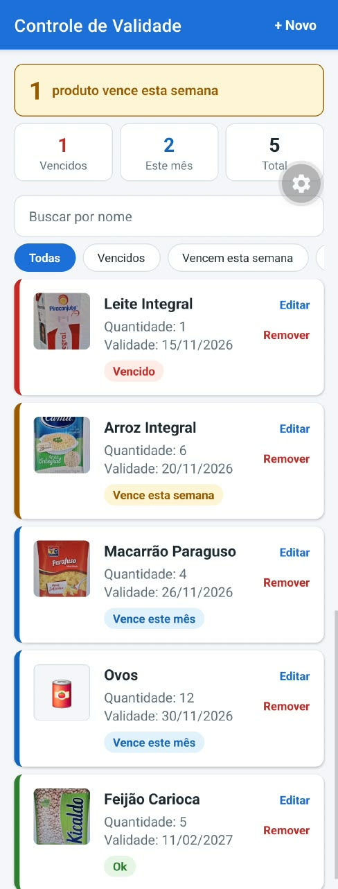
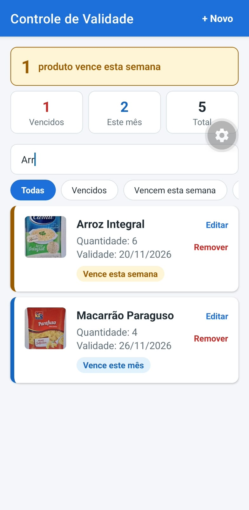
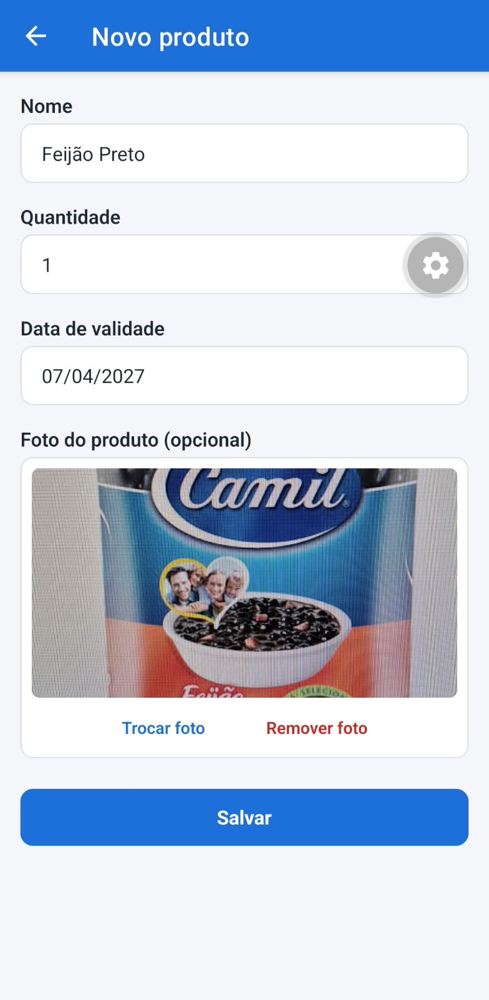
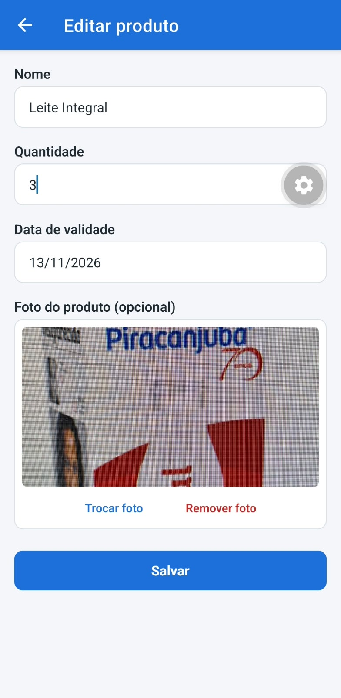
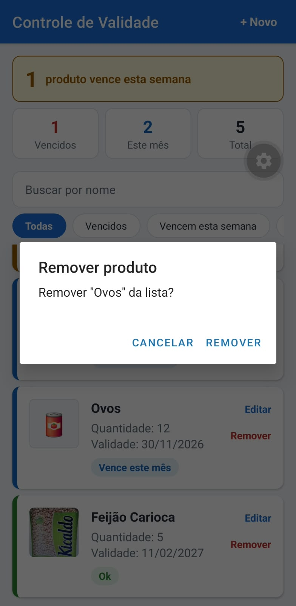

# Controle de Validade de Alimentos

Aplicativo mobile (React Native + Expo) para registro e controle de produtos perecíveis:
cadastro com foto, alerta de itens "vencendo esta semana" e notificações locais antes do vencimento.

**Disciplina:** Programação para Dispositivos Móveis
**Grupo:** Paulo Moura, Arthur Alexandre e João Victor Lucena

**Vídeo de demonstração:** 

https://github.com/user-attachments/assets/20aa1911-a97f-4cdf-a4ca-163aac567105

## Decisões do projeto (fonte de verdade)

- **Plataforma:** Android · **Stack:** React Native (JSX) com Expo, testado no Expo Go
- **Navegação:** React Navigation (native stack, rotas: Inicial, Cadastro e TelaDetalhe).
- **Escopo da Etapa 1:** CRUD completo com persistência local em JSON (expo-file-system)
- **Escopo da Etapa 2:** persistência em banco REMOTO via API (mesma interface do repositório)
- **Identificação do produto:** foto do alimento/rótulo pela câmera. Sem código de barras e sem
  OCR (a validade não vem do EAN; a entrada de data é manual com date picker). OCR descartado
  do MVP por instabilidade técnica.
- **Notificações:** locais, 3 dias antes do vencimento (expo-notifications; atenção à permissão
  no Android 13+)

## Arquitetura e padrão de projeto

Padrão central: **Repository**, em arquitetura em camadas (MVC simplificado).

    Tela (Screen) → ServicoValidade (regras de negócio) → ProdutoRepository (interface)
                                                              ↓
                                                  JsonProdutoRepository (Etapa 1)
                                                              ↓
                                                  produtos.json (FileSystem do dispositivo)

- **Por que Repository:** as telas nunca acessam a origem dos dados diretamente. Na Etapa 2,
  troca-se apenas a implementação (JsonProdutoRepository → ApiProdutoRepository) sem alterar telas.
- **Singleton** no repositório: fonte de verdade única para todas as telas.
- **Modelo:** Produto = id, nome, quantidade, dataDeValidade, fotoUri, dataDeCadastro.
  Regras de vencimento (dias restantes; vencido / esta semana / este mês / ok) centralizadas
  no ServicoValidade.

## Contrato de dados (acordado na issue #1)

O contrato de dados é a base para que os integrantes desenvolvam suas partes de forma independente,
usando dados mockados contra essa interface. A implementação concreta em JSON (`JsonProdutoRepository`)
foi concluída na issue #3 — ver seção abaixo.

**Modelo `Produto`:**
- `id`: Identificador único do produto.
- `nome`: Nome do produto.
- `quantidade`: Quantidade em estoque.
- `dataDeValidade`: Data de validade em formato ISO 8601 (YYYY-MM-DD), armazenada como string.
- `fotoUri`: URI local da foto do produto/rótulo.
- `dataDeCadastro`: Data de cadastro em formato ISO 8601, armazenada como string.

**Interface `ProdutoRepository`:**
- `listar()`: Lista todos os produtos cadastrados.
- `salvar(produto)`: Salva um novo produto.
- `atualizar(produto)`: Atualiza um produto existente.
- `remover(id)`: Remove um produto pelo seu ID.
- `buscarPorId(id)`: Retorna um produto específico pelo ID.

## Dados: JsonProdutoRepository (issue #3)

- **`data/JsonProdutoRepository.js`**: primeira implementação real do contrato
  `ProdutoRepository` (#1), estendendo a classe da interface.
- **Singleton**: `export default new JsonProdutoRepository()`.
- **Persistência**: array de produtos serializado em `produtos.json`, na pasta de
  documentos do app (`FileSystem.documentDirectory`); enquanto o arquivo não existe,
  `listar()` devolve `[]`, e ele é criado na primeira gravação e relido a cada
  operação. Os dados sobrevivem ao fechar e reabrir o app.
- **FileSystem**: usa a mesma API do `CameraService` — `expo-file-system/legacy`
  (`getInfoAsync`, `readAsStringAsync`, `writeAsStringAsync`), alinhada ao SDK 57.
- **Id e data de cadastro**: `salvar()` gera `id` e `dataDeCadastro` (ISO) para
  produtos que chegam sem eles — a tela de cadastro não gera nenhum dos dois (#10);
  valores já informados são mantidos.
- **`dataDeValidade`**: persiste exatamente como string ISO (`'YYYY-MM-DD'`), sem
  conversão de data — decisão do contrato da #1.
- **Erros de leitura/escrita (issue #19)**: nada é engolido em silêncio.
  - **Gravação**: se `writeAsStringAsync` falhar, o erro é registrado no console
    (`[JsonProdutoRepository] ...`) e **relançado**; `salvar`, `atualizar` e `remover`
    propagam a exceção para a tela, que mostra um `Alert` de erro.
  - **Leitura**: arquivo inexistente (primeira execução) continua devolvendo `[]`;
    arquivo existente com erro de leitura ou JSON inválido faz `listar()` **lançar um
    erro explícito** (em português), em vez de devolver `[]`.
  - **Sem regravação de base vazia**: como `listar()` não devolve mais `[]` para uma base
    ilegível, `salvar()` não sobrescreve os dados existentes. Backup fica fora da issue #19.
  - `atualizar(produto)` lança `Produto <id> não encontrado` se o id não existir;
    `remover(id)` com id inexistente continua sem erro (regrava a lista sem alteração).
  - `salvar()` devolve o produto gravado (com o `id` gerado), para o alerta de notificação
    levar o id real (`produtoId`); o contrato `ProdutoRepository` não mudou.
- **Usado pelas telas** `TelaInicial`, `TelaCadastro` e `TelaDetalhe` (a de detalhe, desde a #19).

## Justificativa da tecnologia de persistência (RT02)

A persistência usa `expo-file-system` com um arquivo `produtos.json` e a pasta `fotos/`, em vez de
`AsyncStorage` ou `SQLite`, pelos motivos abaixo:
- O domínio tem uma única entidade simples; um array JSON atende ao volume esperado sem a
  necessidade de consultas relacionais.
- As fotos já precisavam ser gravadas em disco (`documentDirectory/fotos/`); usar a mesma API de
  arquivos para os dados mantém uma única camada de I/O.
- O `JsonProdutoRepository` implementa o contrato `ProdutoRepository`, então trocar a persistência
  pela API remota (Etapa 2) não exige alterar as telas.

Escolhemos o expo-file-system para guardar os dados em um arquivo produtos.json na pasta de documentos do aplicativo, e não o AsyncStorage ou o SQLite, pelos motivos a seguir.

O domínio do app tem uma única entidade, o Produto, com poucos campos e sem relacionamentos. Um array serializado em JSON atende ao volume esperado de itens de uma despensa doméstica, e as operações de listagem, busca e ordenação são feitas em memória pelos serviços. Um banco relacional como o SQLite traria esquema, migrações e consultas que, nesse caso, não resolvem um problema real.

As fotos dos produtos já precisavam ser gravadas em disco, na pasta fotos/, para não se perderem quando o sistema limpa o cache. Usar a mesma API de arquivos para os dados mantém uma única forma de acesso ao armazenamento do dispositivo.

O acesso aos dados fica encapsulado no JsonProdutoRepository, que implementa a interface ProdutoRepository. As telas não conhecem o formato do arquivo. Por isso, na Etapa 2, a persistência local pode ser trocada pela API remota sem alterar as telas, apenas criando outra implementação da mesma interface.

Os dados sobrevivem ao fechamento e à reabertura do aplicativo, o que foi validado no teste manual no Expo Go.

## Regras de vencimento: ServicoValidade (issue #4)

- **`services/ServicoValidade.js`**: regras de vencimento centralizadas na
  camada de serviços — nenhuma tela calcula datas. Serviço puro: recebe o
  `Produto` como parâmetro e não acessa repositório.
- **`calcularDiasRestantes(dataDeValidade)`**: diferença em dias inteiros entre
  a validade e hoje, considerando apenas a DATA (ignora hora) e sem deslocamento
  de fuso — parse local via `isoParaData` (formatoData), nunca
  `new Date('YYYY-MM-DD')` (UTC) nem `toISOString()`.
- **`classificarSituacao(produto)`**: `vencido` (dias < 0), `venceEstaSemana`
  (0 a 7 dias, inclusive hoje), `venceEsteMes` (8 a 30 dias) e `ok` (mais de
  30 dias); as cores das situações (theme da #7) usam essas chaves.
- **Tela de teste temporária** (`TelaTesteServicoValidade`): exibiu os
  casos-limite (ontem, hoje, +7, +8 e +35 dias) com dias restantes e situação
  calculados pelo serviço; removida na #10 junto com os mocks.
- **Uso**: desde a #10 é a única fonte do cálculo de datas — usado pela
  `TelaInicial`, pelo `ServicoDashboard`, pelo `NotificacoesService` e pela `TelaDetalhe`.

## Agregações do dashboard: ServicoDashboard (issue #5)

- **`services/ServicoDashboard.js`**: agregações do dashboard centralizadas
  na camada de serviços — nenhuma tela agrega dados. Serviço puro: recebe
  os produtos como parâmetro e não acessa repositório.
- **`resumirProdutos(produtos)`**: retorna `{ total, vencidos,
  venceEstaSemana, venceEsteMes, ok }`; a classificação de cada produto é
  delegada ao `classificarSituacao` do ServicoValidade (nenhum cálculo de
  data duplicado), então a soma dos quatro contadores é sempre igual ao
  `total`. O contador de `vencido` se chama `vencidos` (com S), nome que o
  `PainelDashboard` usa.
- **`ordenarPorValidade(produtos)`**: nova lista ordenada pela validade mais
  próxima (compara as strings `'YYYY-MM-DD'`, que em ordem alfabética já
  ficam em ordem cronológica); não altera a lista original.
- **Validação**: a tela de teste temporária da #4
  (`TelaTesteServicoValidade`) foi estendida com uma seção "Dashboard" que
  exibia os 5 contadores, a soma dos contadores ao lado do total e a lista
  ordenada — removida na #10 junto com os mocks.
- **Uso**: alimenta a ordenação da listagem e o `PainelDashboard` da
  `TelaInicial` desde a #10.

## Estrutura de pastas (implementada na issue #1)

    app/           → telas (navegação via React Navigation: TelaInicial.js, TelaCadastro.js e TelaDetalhe.js)
    components/    → componentes reutilizáveis (ProdutoCard.js, EmptyState.js, PainelDashboard.js)
    theme/         → tema visual central (theme.js)
    utils/         → utilitários auxiliares (formatoData.js)
    services/      → ServicoValidade (implementado na issue #4), ServicoDashboard (implementado na issue #5), NotificacoesService, CameraService
    data/          → ProdutoRepository (interface) + JsonProdutoRepository (implementado na issue #3)
    __tests__/     → testes unitários (issue #6), de integração (issue #14) e da issue #19 (CameraService, NotificacoesService, IntegracaoEdicao e TelaCadastroEdicao) com Jest
    assets/        → ícones, splash screen e screenshots do README (assets/screenshots/)

A pasta `mocks/` (dados e serviços temporários do bloco de interface) foi removida na issue #10.

## Telas do aplicativo

*Tela inicial: painel de situação e lista ordenada por validade.*

*Busca por nome e filtro por situação.*

*Formulário de cadastro com foto.*

*Edição de produto com campos pré-preenchidos.*

*Tela de detalhe: foto, situação, dias restantes e data de cadastro.*

*Confirmação antes de remover um produto.*

## Interface: tema e componentes (issue #7)

- **Tema central** (`theme/theme.js`): paleta de cores, espaçamentos, raios, tamanhos de
  fonte e estilos base (`estilosBase`). Telas e componentes importam daqui — nada de cores soltas.
- **Cores das situações** (chaves iguais às do `ServicoValidade.classificarSituacao`, issue #4):
  vermelho = `vencido`, amarelo = `venceEstaSemana`, azul = `venceEsteMes`, verde = `ok`.
- **`ProdutoCard`**: recebe `produto` (contrato da #1) e `situacao` (já classificada) e exibe nome,
  quantidade, validade (DD/MM/AAAA), foto quando houver e o selo colorido da situação.
  **Não calcula datas** — só exibe o que recebe.
- **`EmptyState`**: estado de lista vazia com ícone, mensagem e botão de ação opcional.
- **Tela de teste temporária** (`TelaTesteComponentes`): usada na #7 para validar um cartão em
  cada situação e o EmptyState; removida na #9, quando a listagem real passou a usar os componentes.

## Interface: tela de cadastro (issue #8)

- Formulário com **nome**, **quantidade** e **data de validade**, e botão "Salvar".
- **Date picker:** `@react-native-community/datetimepicker` (incluído no Expo Go; instalado com
  `npx expo install`). No Android usa a API imperativa `DateTimePickerAndroid.open`, recomendada
  pela biblioteca. A data é gravada no formato do contrato (`'YYYY-MM-DD'`) a partir da data
  **local** — sem `toISOString()`, que converte para UTC e pode adiantar um dia à noite.
- **Validação** (mensagens em português): nome obrigatório, quantidade inteira maior que zero e
  data obrigatória e não anterior a hoje (datas de hoje e futuras são aceitas).
- Ao salvar, cria um `Produto` do contrato e grava no **`JsonProdutoRepository`** (#3), que gera
  `id` e `dataDeCadastro`; agenda o alerta de vencimento (`NotificacoesService.agendarAlerta`,
  #12), mostra "Produto salvo" e volta à tela inicial. Até a #10 o cadastro gravava num
  repositório mock em memória.

## Interface: tela de listagem (issue #9)

- A tela inicial lista os produtos com o `ProdutoCard`, **ordenados pela validade mais próxima**,
  e recarrega ao ganhar foco (o produto recém-cadastrado aparece ao voltar do cadastro).
- **Busca local** por nome enquanto o usuário digita, sem diferenciar maiúsculas e acentos
  ("lei" encontra "Leite"; "feijao" encontra "Feijão").
- **Filtro por situação**: Todas / Vencidos / Vencem esta semana / Vencem este mês / Ok.
- **EmptyState** quando não há produtos (com botão para cadastrar) e quando a busca ou o filtro
  não encontram nada. Botão "+ Novo" no cabeçalho para abrir o cadastro.
- A tela **não calcula datas**: a situação vem de `ServicoValidade.classificarSituacao` (#4) e a
  ordenação de `ServicoDashboard.ordenarPorValidade` (#5). Os produtos vêm do
  `JsonProdutoRepository` (#3); na primeira execução a lista está vazia e aparece o EmptyState.
  Até a #10 a listagem usava produtos e serviços mock com as mesmas assinaturas.

## Interface: dashboard, remoção e integração com os dados (issue #10)

- **Painel no topo da tela inicial** (`components/PainelDashboard.js`): destaque em âmbar com a
  quantidade de produtos que **vencem esta semana** e contadores de vencidos, deste mês e do total.
  Tocar num contador aplica o filtro correspondente da listagem (o total volta para "Todas").
- Os números vêm de `ServicoDashboard.resumirProdutos(produtos)` (#5):
  `{ total, vencidos, venceEstaSemana, venceEsteMes, ok }`. A classificação é delegada ao
  `ServicoValidade`, então a soma dos contadores é sempre igual ao total.
- **Remoção de produto**: botão "Remover" em cada cartão, com confirmação; chama `remover(id)` do
  `JsonProdutoRepository` e recarrega a lista e o painel.
- **Sem mocks no fluxo principal**: `TelaInicial` e `TelaCadastro` usam o `JsonProdutoRepository`
  (#3), o `ServicoValidade` (#4) e o `ServicoDashboard` (#5). A pasta `mocks/` e a tela de teste
  temporária `TelaTesteServicoValidade` foram removidas.
- **Cálculo de datas em um só lugar**: o `NotificacoesService` (#12) passou a usar o
  `calcularDiasRestantes` do `ServicoValidade` em vez de uma cópia própria.
- **Alerta ao cadastrar**: ao salvar, o cadastro chama `NotificacoesService.agendarAlerta(produto)`,
  que agenda o aviso 3 dias antes do vencimento (ou dispara na hora, se faltar menos que isso).
- **Falha na cópia da foto**: se `CameraService.persistirFoto` não conseguir copiar a foto, o
  cadastro pergunta se o produto deve ser salvo sem foto, em vez de salvar sem ela em silêncio.

## Interface: detalhe, edição e remoção completa (issue #19)

- **Tela de detalhe (`app/TelaDetalhe.js`, rota `TelaDetalhe`)**: recebe só `route.params.produtoId`
  e carrega o produto com `repositorio.buscarPorId` **sempre que ganha foco** (reflete edições).
  Exibe foto ampliada (ou o placeholder `🥫`), nome, quantidade, data de validade e
  `dataDeCadastro` formatadas (DD/MM/AAAA), situação (`classificarSituacao`) e dias restantes
  (`calcularDiasRestantes`), ambos do `ServicoValidade`. Botões **Editar** e **Remover**. Se o
  produto não existir (ou a base não puder ser lida), mostra a mensagem e um botão "Voltar".
- **Cartão (`ProdutoCard`)**: além de `onRemover`, aceita `onPress` (tocar no corpo do cartão abre
  a `TelaDetalhe`) e `onEditar` (botão "Editar", abre a `Cadastro` em modo edição).
- **Edição (`TelaCadastro`)**: com `route.params.produto` a tela entra em modo edição (título
  "Editar produto"; "Novo produto" na criação), pré-preenche os campos, mantém `id` e
  `dataDeCadastro` originais e chama `repositorio.atualizar()` — nunca `salvar()`. Depois de
  atualizar, cancela e reagenda o alerta e volta à tela anterior. As validações valem nos dois modos.
  Se `atualizar()` ou `salvar()` falhar, mostra `Alert` "Erro ao salvar" com a mensagem do erro,
  não mostra "Produto salvo", não navega e não altera a base. O botão "Remover foto" continua
  disponível nos dois modos.
- **Remoção completa** (`TelaInicial` e `TelaDetalhe`), nesta ordem: (1) `NotificacoesService.cancelarAlerta(id)`,
  (2) `repositorio.remover(id)`, (3) `CameraService.removerFoto(fotoUri)` — só se o passo 2 teve sucesso —
  e (4) recarregar a lista/painel. Se o passo 2 falhar, mostra `Alert` de erro e a foto não é apagada.
- **Notificações**: o alerta agendado (e o imediato) leva `content.data.produtoId`; o `identifier`
  não é guardado no produto nem no JSON. `cancelarAlerta(produtoId)` cancela só as notificações
  daquele produto e não lança exceção (falhas vão para o console com `[NotificacoesService]`).
  Alertas criados antes da #19 não têm `produtoId` e não são cancelados por essa função.
- **Fotos**: `CameraService.removerFoto(uri)` só apaga arquivos dentro de
  `documentDirectory/fotos/` (fotos da galeria nunca são apagadas) e não lança exceção. Na edição, a
  foto antiga só é apagada depois de `atualizar()` ter sucesso; se `atualizar()` falhar, apaga-se a
  cópia nova feita naquela tentativa e a original é mantida.
- **Falha ao carregar a lista**: se `listar()` lançar erro, a `TelaInicial` mostra `Alert`
  "Erro ao carregar" e um `EmptyState` de falha, sem regravar nada.
- **Dashboard**: `ServicoDashboard` e `PainelDashboard` não mudaram; a tela inicial recarrega ao
  ganhar foco (inclusive ao voltar do detalhe ou da edição).

## Recursos do dispositivo: câmera e galeria (issue #11)

- **`CameraService` (`services/CameraService.js`)**:
  - Métodos estáticos `tirarFoto()` (abre a câmera) e `escolherDaGaleria()` (abre a galeria).
  - Trata permissões nos três estados: concedida, negada (mensagem clara ao usuário) e negada permanentemente (direcionamento às configurações do sistema via `Linking.openSettings()`).
  - Captura com qualidade comprimida (`quality: 0.6`, `allowsEditing: false`, `mediaTypes: ['images']`), sem guardar imagem original desnecessariamente pesada.
  - Cancelamento gracioso: fechar câmera ou galeria retorna `null` sem quebrar o fluxo nem gerar erro.
  - Retorna string com a URI local da imagem, atendendo ao campo `fotoUri` do contrato `Produto` (#1).
- **Tela de teste temporária (`TelaTesteCamera.js`)**:
  - Usada na #11 para validação isolada, com botões "Tirar foto" e "Escolher da galeria".
  - Removida na #14, quando o fluxo real do cadastro passou a ser validado de ponta a ponta.

## Recursos do dispositivo: notificações locais (issue #12)

- **`NotificacoesService` (`services/NotificacoesService.js`)**:
  - Serviço puro que recebe o `Produto` como parâmetro (sem acoplamento com repositório).
  - Alertas locais configurados com `expo-notifications`, canal Android com prioridade alta e handler para exibição com app em primeiro plano.
  - Regra de antecedência de 3 dias: produtos vencendo em até 3 dias (ou já vencidos) disparam notificação imediata (em 2s); produtos com folga maior são agendados para 3 dias antes da validade, às 09:00.
  - Mensagens em português adaptadas ("venceu há X dias!", "vence hoje!", "vence amanhã!", "vence em X dias!").
  - Trata permissões com aviso claro e link para as configurações do sistema (`Linking.openSettings()`).
  - Funções auxiliares `listarAgendadas()` e `cancelarTodas()`.
  - Dias restantes calculados pelo `ServicoValidade` (#4) desde a #10; o `agendarAlerta` é chamado pela `TelaCadastro` ao salvar cada produto.
- **Tela de teste temporária (`TelaTesteNotificacoes.js`)**:
  - Usada na #12 para agendar 3 cenários ("Vence amanhã", "Já vencido" e "Com folga") e listar/cancelar os agendamentos.
  - Removida na #14, quando o alerta ao cadastrar passou a ser validado no fluxo real.

## Recursos do dispositivo: integração da foto no fluxo do app (issue #13)

- **Persistência de imagens (`CameraService.persistirFoto`)**:
  - Salva as fotos temporárias da câmera e da galeria na pasta permanente de documentos do aplicativo (`FileSystem.documentDirectory/fotos/`), impedindo perda de dados quando o sistema operacional limpa o cache do aparelho.
- **Tela de cadastro (`TelaCadastro.js`)**:
  - Botão "Adicionar foto" integrado ao formulário, permitindo escolher entre capturar pela câmera ou escolher da galeria via `CameraService`.
  - Exibição da pré-visualização da imagem com os botões "Trocar foto" e "Remover foto".
  - Gravação do produto com a URI persistente no campo `fotoUri` ou `null` quando salvo sem foto; se a cópia da foto falhar, o usuário escolhe se salva sem foto (#10).
- **Cartão do produto (`ProdutoCard.js`)**:
  - Exibe a foto persistida do produto quando `fotoUri` estiver definido.
  - Exibe placeholder estilizado com ícone `🥫` quando o produto for cadastrado sem foto ou em caso de falha no carregamento (`onError`).

## Validação final da Etapa 1 (issue #14)

- **Testes de integração** (`__tests__/IntegracaoEtapa1.test.js`): exercitam `JsonProdutoRepository`,
  `ServicoValidade`, `ServicoDashboard`, `CameraService.persistirFoto` e `NotificacoesService.agendarAlerta`
  em conjunto, com o cenário de 5 produtos (1 vencido, 2 vencendo esta semana — um com foto e um sem —,
  1 vencendo este mês e 1 ok). Conferem a persistência em `produtos.json`, a foto persistida, a ordenação
  por validade, a classificação, os contadores do dashboard antes e depois de uma remoção e os alertas
  (imediato para quem vence em até 3 dias, agendado para quem tem folga).
- **Validação manual no Expo Go (SDK 57, Android)** — resultado: **sem erros**.
  - Cadastro com foto pela câmera, salvamento e persistência em `produtos.json`.
  - Listagem ordenada por validade, busca por nome e filtro por situação.
  - Painel do dashboard com os contadores corretos para os 5 produtos e atualização ao remover.
  - Notificação local ao cadastrar produto vencendo em menos de 3 dias.
  - Foto e produtos continuam visíveis após fechar e reabrir o app.
- **Limpeza**: as telas de teste temporárias (`TelaTesteCamera` e `TelaTesteNotificacoes`), suas rotas no
  `App.js` e o botão "Testes" do cabeçalho foram removidos; o fluxo real cobre as duas validações.
- **Testes unitários da #6** continuam passando após as integrações (`npx jest`).

## Fluxo de trabalho Git (regra do grupo)

- Desenvolvimento exclusivamente na branch **`dev`**
- Merge para **`main`** quando estável — `main` é a branch de publicação/entrega
- **Toda outra branch é excluída** após ser mesclada (nada de branches permanentes extras)
- Mensagens de commit no padrão **Conventional Commits** (`feat:`, `fix:`, `chore:`, `docs:`)
- Commits finais feitos pelo grupo, após revisão das alterações

## Divisão de responsabilidades — Etapa 1

Cada integrante é responsável por 4 issues, desenvolvidas de forma independente
contra o contrato de dados definido na issue #1 (modelo `Produto` e interface
`ProdutoRepository`), usando mocks onde a integração só ocorre no fim do bloco.

| Integrante | Bloco | Issues | Responsabilidades |
|---|---|---|---|
| Paulo Moura | Dados e regras | #3–#6 | `JsonProdutoRepository` (CRUD em JSON), `ServicoValidade` (regras de vencimento), `ServicoDashboard` (agregações), testes unitários |
| Arthur Alexandre | Interface | #7–#10 | Tema visual e componentes reutilizáveis, tela de cadastro (formulário + date picker), tela de listagem (busca e filtro), dashboard "vencendo esta semana" e troca do mock pelo repositório real |
| João Victor Lucena | Recursos do dispositivo | #11–#14 | `CameraService` (foto/galeria com permissões), `NotificacoesService` (alertas locais 3 dias antes do vencimento), integração da foto no fluxo do app, testes de integração e validação final |

## Regra de manutenção deste README

⚠️ Este README é **fonte de verdade viva**: a cada issue concluída, ele deve ser
corrigido/adaptado para permanecer coerente com o contexto e o andamento do projeto.
Manter o README atualizado integra os critérios de aceite de cada issue no GitHub.

## Licença

Distribuído sob a **Licença MIT** — ver o arquivo `LICENSE`.
Copyright (c) 2026 Paulo Moura Menezes, Arthur Alexandre e João Victor Lucena.

## Como executar

    npm install
    npx expo start

Escaneie o QR Code com o Expo Go (celular e PC na mesma rede Wi-Fi).

## Testes

Testes unitários e de integração executados com **Jest** utilizando o preset **`jest-expo`**.

    npm test
    # ou
    npx jest

- **`ServicoValidade` (`__tests__/ServicoValidade.test.js`)**: testes das funções `calcularDiasRestantes` (passado, hoje e futuro) e `classificarSituacao` cobrindo todos os casos-limite da issue #4 (`vencido`, `venceEstaSemana`, `venceEsteMes` e `ok`).
- **`JsonProdutoRepository` (`__tests__/JsonProdutoRepository.test.js`)**: testes de persistência cobrindo o fluxo completo de CRUD (salvar com id gerado, buscarPorId, atualizar e remover), a geração de `id` e `dataDeCadastro` quando o produto chega sem eles e o caso de arquivo inexistente (retorna lista vazia sem erro), com mock em memória de `expo-file-system/legacy`. Na issue #19 foram acrescentados: `atualizar()` (substitui pelo id, mantém o total e preserva `dataDeCadastro`; id inexistente lança erro), `listar()` com JSON inválido ou falha de leitura (lança erro, não devolve `[]`), falha de escrita propagada para `salvar`/`atualizar`/`remover` e `salvar()` que não sobrescreve a base quando `listar()` falha.
- **`IntegracaoEtapa1` (`__tests__/IntegracaoEtapa1.test.js`)**: testes de integração da Etapa 1 (issue #14) verificando as peças funcionando em conjunto (`JsonProdutoRepository`, `ServicoValidade`, `ServicoDashboard`, `CameraService.persistirFoto` e `NotificacoesService.agendarAlerta`) no cenário completo de 5 produtos.
- **`NotificacoesService` (`__tests__/NotificacoesService.test.js`, issue #19)**: `cancelarAlerta` cancela só as notificações do `produtoId` (sem lançar exceção quando não há nenhuma ou quando o cancelamento falha) e `agendarAlerta` inclui `produtoId` em `content.data`, tanto no alerta imediato quanto no agendado.
- **`CameraService.removerFoto` (`__tests__/CameraService.test.js`, issue #19)**: apaga dentro de `documentDirectory/fotos/`, não apaga fora dessa pasta, ignora uri vazia e não lança exceção se o arquivo não existir ou a exclusão falhar.
- **`IntegracaoEdicao` (`__tests__/IntegracaoEdicao.test.js`, issue #19)**: edita um produto da base de 5 itens e confere a listagem, a ordenação, a situação calculada, os contadores do dashboard e o reagendamento do alerta.
- **`TelaCadastroEdicao` (`__tests__/TelaCadastroEdicao.test.js`, issue #19)**: renderiza a `TelaCadastro` (com `react-test-renderer`, já instalado pelo `jest-expo`) nos modos criação e edição — pré-preenchimento, `atualizar()` com `id` e `dataDeCadastro` preservados, troca e remoção de foto com apagamento da antiga, falha de gravação sem "Produto salvo" e sem alterar a base, e descarte da foto nova quando `atualizar()` falha.

## Histórico de decisões

- 2026-10-01 — Repositório inicializado; scaffold do Expo (template blank) mesclado ao `main`;
  `.gitignore` unificado; fluxo de branches `dev` → `main` definido.
- 2026-10-01 — Licença do template do Expo substituída por MIT própria do grupo; README
  consolidado com navegação via React Navigation.
- 2026-10-02 — Plano da Etapa 1 concluído: 14 issues criadas no GitHub (2 de
  fundação + 4 por integrante, blocos independentes contra o contrato da #1);
  `NotificacoesService` movida para o bloco do João; labels `setup`, `feat` e `docs` configuradas.
- 2026-10-02 — Issue #1 concluída: estrutura de pastas (app, components, services, data) criada; contrato de dados definido (Produto + ProdutoRepository), base para os blocos independentes da Etapa 1.
- 2026-10-02 — Issue #2 concluída: React Navigation configurado (NavigationContainer + native stack); telas TelaInicial e TelaCadastro criadas em app/; navegação Inicial → Cadastro → Voltar funcional.
- 2026-10-13 — Issue #7 concluída: tema visual central (`theme/theme.js`) e componentes
  reutilizáveis `ProdutoCard` e `EmptyState`, validados na tela de teste temporária com produtos mock
  nas 4 situações; cabeçalho da navegação usando as cores do tema.
- 2026-10-13 — Issue #8 concluída: tela de cadastro com formulário validado e date picker
  (`@react-native-community/datetimepicker`), salvando em repositório mock em memória
  (`mocks/`), que segue o contrato da #1.
- 2026-10-13 — Issue #9 concluída: tela inicial transformada na listagem com `ProdutoCard`,
  ordenação por validade, busca local por nome, filtro por situação e EmptyState; situação e
  ordenação vindas de serviços mock com as assinaturas das issues #4 e #5; tela de teste da #7
  removida.
- 2026-10-14 — Issue #11 concluída: `CameraService` criado com `tirarFoto()` e `escolherDaGaleria()`, compressão de imagens, tratamento de permissões e cancelamento gracioso; validado na tela de teste `TelaTesteCamera`.
- 2026-10-14 — Issue #12 concluída: `NotificacoesService` criado com `agendarAlerta()`, regra de antecedência de 3 dias, mensagens em português e listagem de agendamentos; validado na tela de teste `TelaTesteNotificacoes`.
- 2026-10-14 — Issue #13 concluída: integração da captura de foto (câmera/galeria) no cadastro, persistência no FileSystem e exibição da foto ou placeholder no ProdutoCard.
- 2026-10-14 — Issue #10, parte visual: painel do dashboard "vencendo esta semana" e remoção de
  produto na tela inicial, ainda via mock; a troca pelo repositório e pelos serviços reais aguarda
  as issues #3 e #5. Alerta de foto do cadastro ajustado ao limite de 3 botões do Android.
- 2026-10-23 — Issue #3 concluída: `JsonProdutoRepository` (CRUD real em JSON via
  `expo-file-system/legacy`, arquivo `produtos.json` no documentDirectory, id
  gerado pelo repositório quando ausente, erros de leitura/escrita tratados no
  console). Telas seguem no mock até a #10.
- 2026-10-23 — Issue #4 concluída: `ServicoValidade` com
  `calcularDiasRestantes` e `classificarSituacao` (faixas vencido / esta
  semana / este mês / ok, iguais ao mock), cálculo só-data sem fuso e tela de
  teste temporária com os casos-limite. Telas seguem no mock até a #10.
- 2026-10-24 — Issue #5 concluída: `ServicoDashboard` com `resumirProdutos`
  (5 contadores, classificação delegada ao ServicoValidade, soma sempre
  igual ao total) e `ordenarPorValidade` (lista nova, sem mutar a original),
  semântica idêntica ao mock. Tela de teste temporária estendida com a
  seção "Dashboard". Telas seguem no mock até a #10.
- 2026-10-24 — Issue #6 concluída: configuração do Jest/jest-expo e testes unitários do bloco de dados (issue #6).
- 2026-10-24 — Issue #10 concluída: telas integradas ao `JsonProdutoRepository`, ao
  `ServicoValidade` e ao `ServicoDashboard`; `id` e `dataDeCadastro` gerados pelo repositório;
  alerta de vencimento agendado ao salvar; aviso quando a cópia da foto falha;
  `NotificacoesService` usando o cálculo de datas do `ServicoValidade`; pasta `mocks/` e
  `TelaTesteServicoValidade` removidas.
- 2026-10-24 — Issue #14 concluída (fim da Etapa 1): testes de integração com o cenário de 5
  produtos (`__tests__/IntegracaoEtapa1.test.js`), validação manual de ponta a ponta no Expo Go
  (SDK 57) sem erros e remoção das telas de teste temporárias `TelaTesteCamera` e
  `TelaTesteNotificacoes`, de suas rotas e do botão "Testes" do cabeçalho.
- 2026-11-16 — Issue #19 concluída: edição, tela de detalhe, robustez da persistência e limpeza de
  notificações e fotos. Validada no Expo Go (fluxos de edição, detalhe, remoção e persistência).
  Entregue em `dev` (commit `9bf785f`) e integrada à `main` (merge `1aa57c3`).