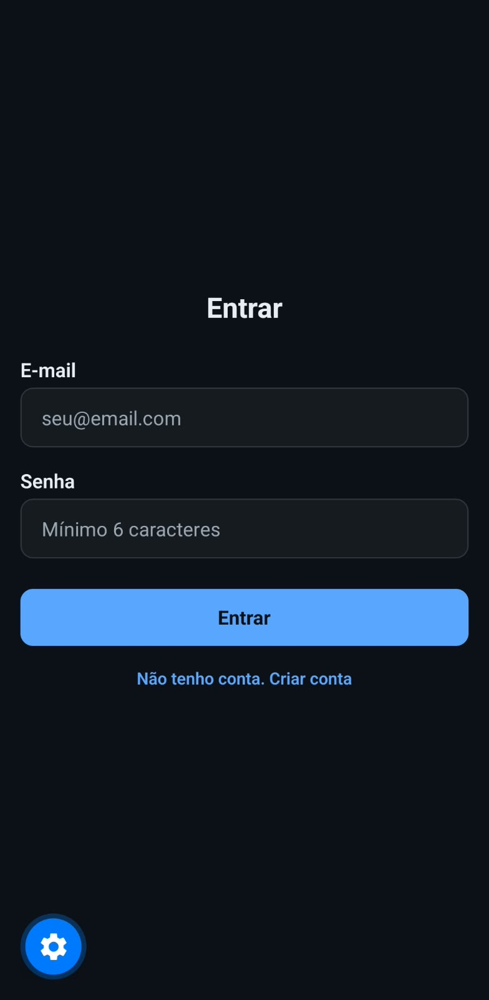
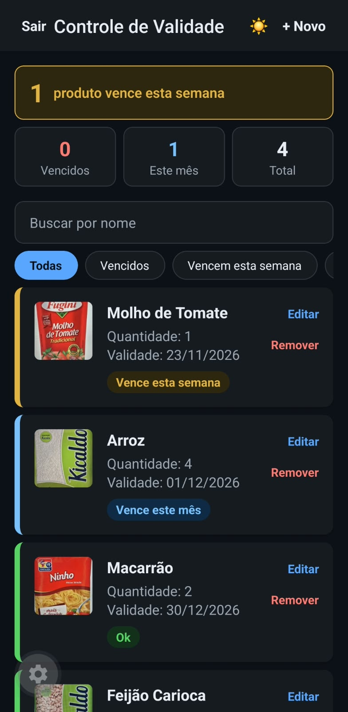
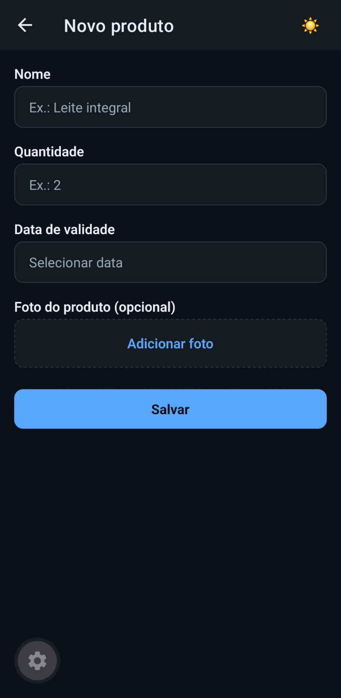
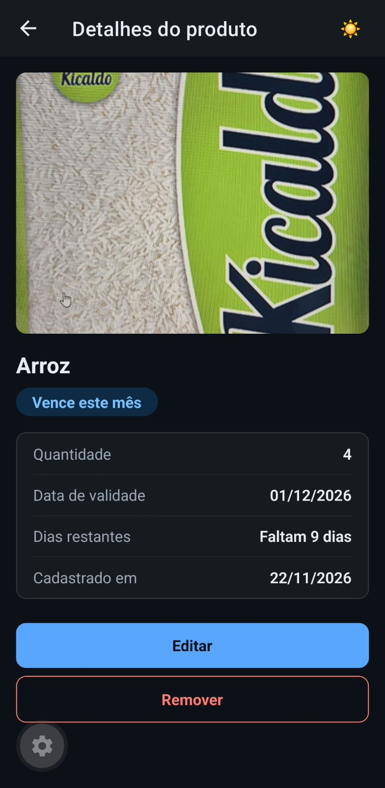
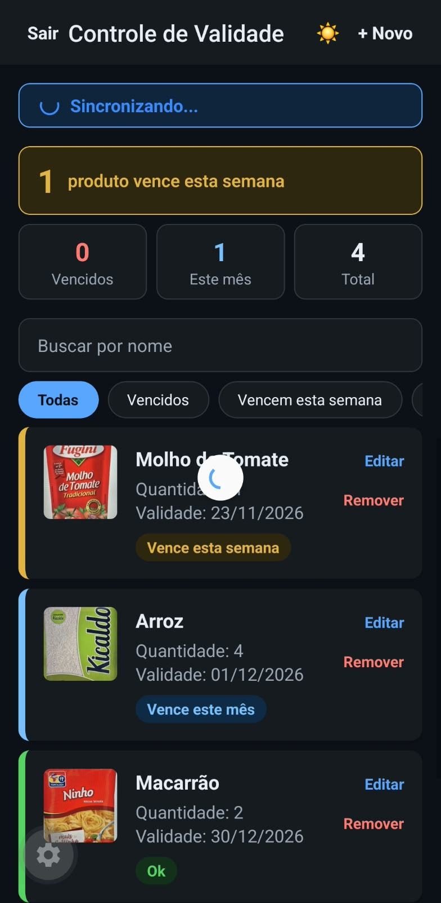
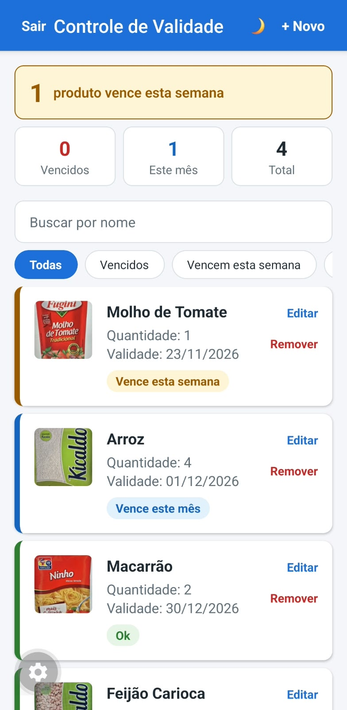

# Documentação — Controle de Validade de Alimentos

## 1. Tema e objetivo

O projeto é um aplicativo mobile em React Native com Expo para controle de validade de alimentos perecíveis, criado para reduzir perdas por vencimento não percebido e falta de aviso antecipado. O sistema oferece autenticação de conta, cadastro e edição de produtos com foto, listagem ordenada por validade com busca por nome, filtros por situação, painel de contadores, tela de detalhes, remoção, alertas locais 3 dias antes do vencimento, sincronização offline-first com a nuvem e alternância entre tema claro e escuro.

## 2. Modelo de dados

Tabela `Produto` (modelo do cliente em `data/Produto.js` e tabela `produtos` em `backend/src/banco.js`):

| Campo | Tipo | Descrição |
| --- | --- | --- |
| `id` | `string` (`VARCHAR(255)`) | Identificador único do produto. |
| `nome` | `string` (`VARCHAR(255)`) | Nome do alimento cadastrado. |
| `quantidade` | `number` (`INT`) | Quantidade em estoque (inteiro positivo). |
| `dataDeValidade` | `string` (`DATE`, `'YYYY-MM-DD'`) | Data de validade em texto ISO sem horário. |
| `fotoUri` | `string \| null` (`TEXT`) | URI local da foto em `fotos/` ou `null`. |
| `dataDeCadastro` | `string` (`TIMESTAMP`, ISO 8601) | Data e hora de registro do produto. |

Tabela `usuarios` (schema em `backend/src/banco.js`):

| Campo | Tipo | Descrição |
| --- | --- | --- |
| `id` | `SERIAL PRIMARY KEY` | Identificador numérico único do usuário. |
| `nome` | `VARCHAR(255) NOT NULL` | Nome do titular da conta. |
| `email` | `VARCHAR(255) NOT NULL UNIQUE` | E-mail único usado para autenticação. |
| `senhaHash` | `VARCHAR(255) NOT NULL` | Hash bcrypt (custo 12) da senha; nunca retornado pela API. |

Na base PostgreSQL, a tabela `produtos` possui chave primária composta `(id, "usuarioId")` e a coluna `"usuarioId"` (`INT NOT NULL`) referencia `usuarios(id)` por chave estrangeira, sem cláusula de exclusão em cascata, garantindo o isolamento dos registros por conta.

## 3. Justificativa da persistência (três camadas)

**3.1 Local:** no diretório de documentos do dispositivo, via `expo-file-system/legacy`, ficam `produtos.json` (cache de produtos), `sessao.json` (sessão autenticada), `fila_sincronizacao.json` (fila offline), `tema.json` (preferência visual) e a pasta `fotos/`. A escolha foi feita porque os dados são listas pequenas, o acesso é sempre por lista completa e a gravação atômica por arquivo temporário e renomeação (usada na fila) é direta; AsyncStorage é chave-valor sem controle explícito de escrita atômica por arquivo nem estrutura legível do conjunto, e SQLite adiciona dependência nativa e modelagem relacional desnecessária sem consultas complexas no cliente.

**3.2 Nuvem:** na API Express hospedada no Render, conectada ao banco PostgreSQL gerenciado no Neon, ficam armazenadas as tabelas `usuarios` e `produtos`, com acesso autenticado por token JWT válido por 30 dias. PostgreSQL foi escolhido por ser um servidor multiusuário com acesso concorrente remoto e serviço gerenciado (Neon), enquanto SQLite é um arquivo local sem acesso concorrente remoto e inadequado a hospedagem em PaaS sem volume persistente.

**3.3 Offline-first:** no repositório `OfflineFirstProdutoRepository`, cada escrita grava primeiro no cache local, registra a operação (`SALVAR`, `ATUALIZAR` ou `REMOVER`) com `usuarioId` na fila FIFO em `fila_sincronizacao.json` e dispara envio em segundo plano. A fila é drenada contra a API ao abrir ou focar a listagem, ao tocar no indicador de sincronização ou ao puxar a lista para atualizar; esvaziada a fila do usuário, o cache local espelha os dados remotos.

## 4. Escolha do roteador

O requisito RF05 do PDF cita o Expo Router; o projeto usa React Navigation porque o template base é o blank do Expo e o expo-router foi descartado na fase de decisões. A navegação em pilha nativa (`@react-navigation/native-stack` em `App.js`) separa o fluxo de autenticação (`Login`) da pilha principal (`Inicial`, `Cadastro` e `TelaDetalhe`), impedindo retorno ao login após autenticar.

## 5. Capturas de tela comentadas

Entrada com e-mail e senha, com criação de conta pelo link na mesma tela.

Lista ordenada por validade, com painel de contadores, busca, filtros e ações de editar e remover.

Formulário com nome, quantidade, data de validade e foto opcional.

Dias restantes, data de cadastro e ações de editar e remover o produto.

Banner "Sincronizando..." exibido na listagem enquanto as operações pendentes são enviadas à API.

Alternância entre tema claro e escuro, com a preferência salva localmente.
